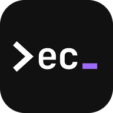
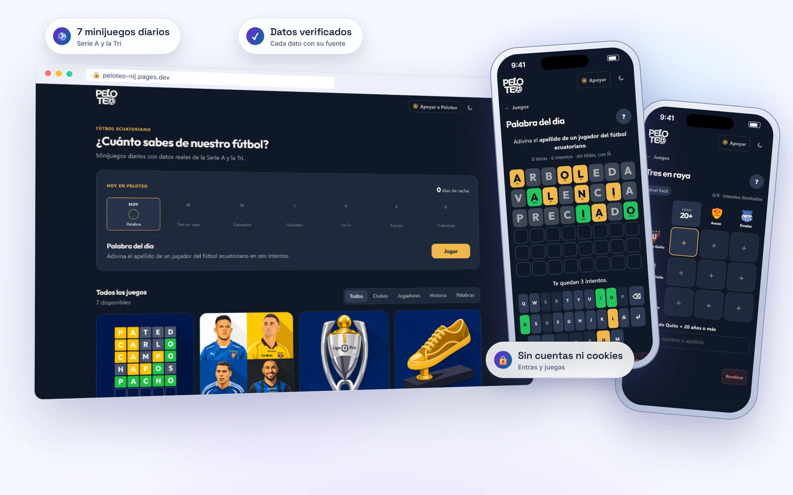

<picture>
  <source media="(prefers-color-scheme: dark)" srcset="assets/ec-dark.png">
  
</picture>

# Erick Carcelén

**Software developer · Web, data & applied AI**  
Quito, Ecuador

I study engineering at Escuela Politécnica Nacional and help build internal tools and interactive demos as an IT intern at WellPerf.

[Portfolio][portfolio] · [LinkedIn][linkedin]

## Selected projects

### Peloteo

Daily minigames about Ecuadorian football, from a word-of-the-day challenge to player tic-tac-toe. I built it with React, TypeScript, and PostgreSQL, and verify the football data against published sources.

<picture>
  <source media="(prefers-color-scheme: dark)" srcset="assets/peloteo-dark.webp">
  
</picture>

[Play Peloteo][peloteo]

### More projects

- **AI WhatsApp Assistant** — Answers questions about nearby laundry locations and promotions, and takes pickup requests. A live dashboard gives staff visibility into conversations. Built with FastAPI, Gemini, React, and the WhatsApp Cloud API.
- **ARGOS** — Python desktop app for viewing live RTSP camera feeds, controlling camera movement, and sending Telegram alerts when it detects a person.
- **Oil & Power** — A touch-screen game for WellPerf's trade show booth. Players interpret gamma ray and resistivity logs to locate an oil reservoir. Built with Godot 4.
- **WellPerf Internal Platform** — Staff portal for digital credentials, attendance, purchases, and requisitions, with corporate sign-in and PDF reports. Built with Next.js, PostgreSQL, and Microsoft Entra ID.

[See the full project gallery][projects]

[portfolio]: https://erickc162.github.io/
[projects]: https://erickc162.github.io/#proyectos
[linkedin]: https://www.linkedin.com/in/erick-carcel%C3%A9n/
[peloteo]: https://peloteo-nij.pages.dev/
